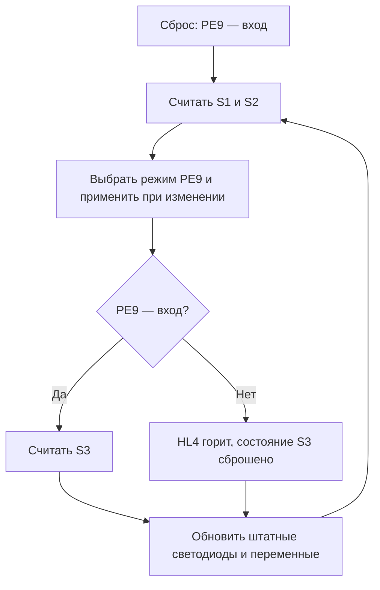

# Лабораторная работа № 1. GPIO, вариант 4

Плата из курсового проекта — STM32F407G Discovery с STM32F407VGT6. Задание на с. 53 методических указаний предусматривает три кнопки и четыре светодиода. Кнопка S1 переводит общую линию в режим входа и при удержании зажигает красный светодиод. S2 переводит линию в режим выхода и при удержании зажигает синий. В режиме входа удержание S3 зажигает оранжевый штатный светодиод Discovery, который выполняет роль жёлтого из задания. В режиме выхода горит внешний светодиод на общей линии.

## Исходники

| Вариант | Доступ к периферии |
| --- | --- |
| `registers` | Разыменование указателей `volatile uint32_t *` по физическим адресам регистров |
| `macros` | Собственные регистры, маски и операции `READ_BIT`, `SET_BIT`, `CLEAR_BIT`, `WRITE_REG` в `Core/Inc/macros/init.h` |
| `cmsis` | Структуры регистров, маски и операции CMSIS для STM32F407 через `stm32f4xx.h` |

Структура следует шаблону `Laboratory_Practice`. Исходники находятся в `Core/Src`, заголовки в `Core/Inc`, а в корне есть `Makefile` с целями сборки и прошивки. Внутри `Src` и `Inc` используются подпапки `registers`, `macros` и `cmsis`, чтобы выбирать одну реализацию при сборке.

У каждой версии свои `main.c`, `init.c` и `init.h`. В `main.c` находится опрос кнопок, в `init.c` — работа с GPIO, а в `init.h` — объявления функций. В версиях на регистрах и макросах пустая `SystemInit()` находится в `init.c`. В версии CMSIS она берётся из библиотеки. Стартовый файл и скрипт компоновщика STM32F407VG находятся в `STMDevices/STM32F407xx`.

## Схема подключения

Ниже номера контактов разъёма P1 по UM1472. На плате ориентируйтесь также по маркировке PE7–PE10. У всех внешних компонентов общая земля с платой.

| Сигнал | Подключение | Назначение |
| --- | --- | --- |
| PE7 (P1.25) | S1 между PE7 и GND | Режим входа |
| PE8 (P1.26) | S2 между PE8 и GND | Режим выхода |
| PE9 (P1.27) | S3 и внешний HL4 | Общая линия с переключаемым направлением |
| PE10 (P1.28) | Через 330 Ом к аноду HL4, катод HL4 к PE9 | Питание HL4 в режиме выхода |
| PD14, PD15, PD13 | Штатные LD5, LD6, LD3 | Красный, синий, оранжевый |

```text
PE7 (P1.25) ── S1 ── GND
PE8 (P1.26) ── S2 ── GND
PE9 (P1.27) ── S3 ── GND

PE10 (P1.28) ── 330 Ом ── анод HL4 → катод HL4 ── PE9 (P1.27)
```

Для HL4 подойдёт обычный красный светодиод. S1, S2 и S3 — нормально разомкнутые кнопки. Используйте контакт GND платы. Для всех трёх кнопок подтяжка к питанию включена программно, поэтому нажатие даёт логический ноль. Единственный внешний резистор, 330 Ом, ограничивает ток HL4.

| Режим PE9 | PE9 | PE10 | HL4 |
| --- | --- | --- | --- |
| Вход | Вход с внутренней подтяжкой вверх, считывает S3 | Вход без подтяжки, высокоимпедансное состояние | Выключен |
| Выход | Открытый сток, активно тянет линию к GND | Выход push-pull, выдаёт логическую единицу | Включён |

В режиме выхода нажатие S3 соединяет PE9 с той же землёй, к которой его уже тянет открытый сток. Ток от PE10 в обеих ситуациях проходит через 330 Ом и HL4. Используйте эту разводку с обновлённой прошивкой. Если на плате записана предыдущая версия с активной единицей на PE9, сначала прошейте новую версию и затем подключите S3.

В режиме выхода цепь тока замкнута через сам микроконтроллер. Ток идёт от PE10 через резистор и HL4 в PE9, а затем через открытый транзистор выходного каскада PE9 в GND. Катод остаётся на PE9, чтобы этот же узел можно было использовать как вход S3. Постоянное соединение катода с GND зафиксировало бы на PE9 логический ноль, и контроллер всегда считывал бы S3 как нажатую.

### Изменения в коде

Во всех трёх реализациях `GPIO_Ini()` задаёт для PE9 тип выхода open-drain через `OTYPER`. Через `BSRR` заранее записываются 0 для PE9 и 1 для PE10, пока оба вывода работают как входы. `GPIO_SetSharedOutput()` меняет поля `MODER`. При переходе на выход сначала подключается низкий уровень PE9, затем подаётся питание HL4 через PE10. При возврате на вход сначала отключается питание HL4, затем PE9 снова начинает считывать S3.

## Алгоритм

После сброса PE9 работает как вход. Программа опрашивает кнопки в цикле `while (1)`. S1 выбирает вход, S2 выбирает выход. Режим сохраняется после отпускания кнопки. При одновременном нажатии приоритет имеет S1. S3 считывается только в режиме входа.



## Подключение Laboratory_Practice и сборка

Откройте папку `lab1-variant4` в VS Code через **Файл → Открыть папку**. Команды ниже выполняются в терминале PowerShell из этой папки. Компилятор GNU Arm должен быть в `PATH`. Проверка установки:

```powershell
arm-none-eabi-gcc --version
```

Папка `lab1-variant4` сама является Git-репозиторием на основе истории локального клона шаблона. В корне находятся `Core`, `CMSIS`, `STMDevices` и `Makefile`. Ветка лабораторной — `codex/lab1-variant4`. Адрес `origin` указывает на `mrmdev-prog/Laboratory_Practice`, а `upstream` на `L-a-s-k-a/Laboratory_Practice` из методички по инфраструктуре. Проверить адреса можно командой `git remote -v`.

Сборка выполняется напрямую через GNU Make. `C_SOURCES` включает `main.c` и `init.c` выбранной версии, `C_INCLUDES` задаёт путь к её заголовкам и добавляет пути CMSIS для версии `cmsis`.

```powershell
mingw32-make VARIANT=all
mingw32-make flash VARIANT=cmsis
```

Для сборки одной версии укажите `VARIANT=registers`, `VARIANT=macros` или `VARIANT=cmsis`. По умолчанию собирается CMSIS. Для каждой версии в `build/<версия>/` появляются `lab1.elf`, `lab1.hex`, `lab1.bin` и `lab1.map`.

В VS Code сочетание **Ctrl+Shift+B** собирает все версии. Для отладки выберите в **Run and Debug** конфигурацию **STM32F407VG — Регистры**, **Макросы** или **CMSIS** и нажмите **F5**. Cortex-Debug соберёт выбранную версию, загрузит её через OpenOCD и остановится на `main`. Файл `STM32F407.svd` используется для просмотра регистров. Для подсказок редактора выберите такую же конфигурацию через **C/C++: Select IntelliSense Configuration**.

## Прошивка и проверка

Подключите USB к разъёму ST-LINK и выберите одну сборку. Пример для CMSIS при установленном OpenOCD:

```powershell
openocd -f interface/stlink.cfg -c 'transport select swd' -f target/stm32f4x.cfg -c 'program build/cmsis/lab1.elf verify reset exit'
```

| Действие | Ожидаемое поведение |
| --- | --- |
| Сброс без нажатых кнопок | PE9 в режиме входа, все четыре светодиода выключены |
| Удержать S3, затем отпустить | Оранжевый горит при удержании, HL4 выключен |
| Удержать S2, затем отпустить | Синий горит при удержании, HL4 остаётся включённым после отпускания |
| Нажать S3 в режиме выхода | HL4 продолжает гореть, оранжевый выключен |
| Удержать S1, затем отпустить | HL4 гаснет, красный горит при удержании, PE9 остаётся входом |

Для записи графиков в STMViewer выберите `lab1.elf` той версии, которая записана на плату. Добавьте переменные в **Variable Viewer** и обновите их адреса.

| Переменная | Значения |
| --- | --- |
| `lab_mode` | 0 — вход, 1 — выход |
| `lab_buttons` | Биты 0–2 — состояния S1–S3. В режиме выхода бит S3 равен 0 |
| `lab_leds` | Биты 0–3 — красный, синий, оранжевый, внешний |

Запустите запись и пройдите действия из таблицы. При одинаковой схеме три сборки должны давать одинаковую реакцию. Сборка проверена на GNU Arm, а таблица описывает ожидаемые результаты для проверки на плате.

## Документация

- [Исходный Laboratory_Practice из методички](https://github.com/L-a-s-k-a/Laboratory_Practice)
- [ST UM1472 — схема и распиновка STM32F407G Discovery](https://www.st.com/resource/en/user_manual/dm00039084-stm32f4-discovery-kit-stm32f407vg-mcu-stmicroelectronics.pdf)
- [ST RM0090 — регистры GPIO и RCC](https://www.st.com/resource/en/reference_manual/rm0090-stm32f407-advanced-armbased-32bit-mcus-stmicroelectronics.pdf)
- [STMViewer](https://github.com/klonyyy/STMViewer)
